# 1. Quy trình thu thập dữ liệu

## 1.1. Thiết bị thu thập dữ liệu

Nghiên cứu sử dụng camera đo chiều sâu Intel RealSense D435, tích hợp hai cảm biến hồng ngoại, máy chiếu điểm hồng ngoại và camera RGB, cho phép thu thập đồng thời dữ liệu chiều sâu và hình ảnh màu của môi trường. Camera được kết nối với máy tính qua USB 3.0 và sử dụng phần mềm Intel RealSense Viewer để cấu hình, ghi dữ liệu vào tệp định dạng `.bag`.

  

*Hình 1. Camera Intel RealSense D435 sử dụng trong hệ thống thu thập dữ liệu.*

Để ghi lại hình ảnh theo góc nhìn thứ nhất (First-Person View – FPV), hệ thống sử dụng laptop MSI B12MO với bộ xử lý Intel Core i5-1235U, RAM 16 GB và đồ họa tích hợp Intel Iris Xe. Video được ghi ở độ phân giải 640 × 480 pixel, tốc độ 30 khung hình/giây (FPS).

## 1.2. Bối cảnh và bố trí không gian thực nghiệm

Thí nghiệm được thực hiện trong phòng ăn có diện tích khoảng 15 m², với các chướng ngại vật gồm bàn, ghế và chậu hoa nhằm mô phỏng môi trường sinh hoạt trong nhà. Các marker kích thước 10 × 10 cm được bố trí trên sàn để xác định tuyến đường và thứ tự di chuyển của người tham gia.

  

*Hình 2. Sơ đồ bố trí không gian thực nghiệm, vị trí chướng ngại vật và tuyến đường di chuyển theo các marker.*

## 1.3. Bố trí hệ thống ghi hình

Camera được cố định trước ngực người tham gia, hướng về phía trước để ghi nhận môi trường theo hướng di chuyển. Laptop được đeo phía sau lưng nhằm hỗ trợ ghi và lưu trữ dữ liệu trong suốt quá trình thực nghiệm. Trước mỗi lần ghi hình, hệ thống được kiểm tra để bảo đảm thiết bị hoạt động ổn định.

  

*Hình 3. Bố trí thiết bị ghi hình trên người tham gia: (a) tư thế đeo và hướng camera; (b) vị trí laptop phía sau lưng; (c) vị trí bắt đầu thu thập dữ liệu.*

## 1.4. Quy trình di chuyển và tổ chức dữ liệu

Người tham gia di chuyển theo tuyến đường đã xác định, bắt đầu tại marker số 25, đi qua các marker trung gian và kết thúc tại marker số 24. Mỗi video gồm bốn lượt di chuyển liên tiếp:

1. **Lượt đi 1:** từ marker 25 đến marker 24.
2. **Lượt về 1:** từ marker 24 trở lại marker 25.
3. **Lượt đi 2:** từ marker 25 đến marker 24.
4. **Lượt về 2:** từ marker 24 trở lại marker 25.

Quy trình này giúp thu thập dữ liệu theo cả hai hướng di chuyển và tăng tính nhất quán trong quá trình khảo sát môi trường. Thí nghiệm được thực hiện với năm tình nguyện viên, tương ứng năm video. Sau khi ghi hình, dữ liệu được thống kê theo từng video và từng lượt đi, lượt về để kiểm tra số lượng khung hình. Tổng cộng, bộ dữ liệu thu thập được gồm **46.072 khung hình**, phục vụ các bước xử lý và nghiên cứu tiếp theo.

**Bảng 1. Thống kê số lượng khung hình theo từng lượt di chuyển của 5 video**

<table>
  <thead>
    <tr>
      <th align="center">Video</th>
      <th align="center">Lượt</th>
      <th align="center">Số frame</th>
      <th align="center">Video</th>
      <th align="center">Lượt</th>
      <th align="center">Số frame</th>
    </tr>
  </thead>
  <tbody>
    <tr>
      <td align="center" rowspan="4">1</td>
      <td align="center">Đi 1</td>
      <td align="center">3403</td>
      <td align="center" rowspan="4">4</td>
      <td align="center">Đi 1</td>
      <td align="center">1604</td>
    </tr>
    <tr>
      <td align="center">Về 1</td>
      <td align="center">3165</td>
      <td align="center">Về 1</td>
      <td align="center">1775</td>
    </tr>
    <tr>
      <td align="center">Đi 2</td>
      <td align="center">2593</td>
      <td align="center">Đi 2</td>
      <td align="center">1570</td>
    </tr>
    <tr>
      <td align="center">Về 2</td>
      <td align="center">2359</td>
      <td align="center">Về 2</td>
      <td align="center">1336</td>
    </tr>
    <tr>
      <td align="center" rowspan="4">2</td>
      <td align="center">Đi 1</td>
      <td align="center">2296</td>
      <td align="center" rowspan="4">5</td>
      <td align="center">Đi 1</td>
      <td align="center">3199</td>
    </tr>
    <tr>
      <td align="center">Về 1</td>
      <td align="center">2001</td>
      <td align="center">Về 1</td>
      <td align="center">3149</td>
    </tr>
    <tr>
      <td align="center">Đi 2</td>
      <td align="center">2026</td>
      <td align="center">Đi 2</td>
      <td align="center">2620</td>
    </tr>
    <tr>
      <td align="center">Về 2</td>
      <td align="center">1777</td>
      <td align="center">Về 2</td>
      <td align="center">2177</td>
    </tr>
    <tr>
      <td align="center" rowspan="4">3</td>
      <td align="center">Đi 1</td>
      <td align="center">3052</td>
      <td colspan="3"></td>
    </tr>
    <tr>
      <td align="center">Về 1</td>
      <td align="center">2065</td>
      <td colspan="3"></td>
    </tr>
    <tr>
      <td align="center">Đi 2</td>
      <td align="center">2099</td>
      <td colspan="3"></td>
    </tr>
    <tr>
      <td align="center">Về 2</td>
      <td align="center">1806</td>
      <td colspan="3"></td>
    </tr>
  </tbody>
</table>

*Bảng 1. Thống kê số lượng khung hình theo lượt đi và lượt về của năm video thu thập.*

Trong bài báo này, chúng tôi đề xuất và conducted data collection at the homes of blind participants in Ha Giang 1 Ward, Tuyen Quang (TQ) Province cho việc VOE, called the TQ-BLIND-VOE dataset.

The study involved five blind participants—members of the Tuyen Quang Association of the Blind—aged between 22 and 60. The group consisted of two men and three women (all totally blind, with heights ranging from 1.5m to 1.8m).

Data collection was carried out based on specific indoor movement scenarios; each person made two round trips (out and back). Participants wore an RGB-D camera (Intel RealSense D435). This camera was connected to a laptop. The camera, connected via USB to simultaneously capture RGB image and depth data, was mounted on the participant's back. Each participant took turns navigating from the restroom door (Start)—following a path marked with points 1 through 25—to the house entrance (End), and then back again; safety was ensured through the presence of an assistant who provided supervision and guidance. Cơ sở dữ liệu này bao gồm 46.072 khung hình RGB-D, dữ liệu gốc của cơ sở dữ liệu gốc được chuẩn bị dựa trên path marked with points 1 through 25 do với hệ trục tọa độ của môi trường trong nhà đã được định nghĩa trước.

Đồng thời chúng tôi cũng thực hiện fine-tuning mô hình Monodepth2, MLF–VO, MLF–VO + Loss trên TQ-BLIND-VOE dataset cho VOE theo 5 lần chạy cho 3 cấu hình của dữ liệu (thứ nhất là 5 lần chạy dữ liệu 2 lượt đi của 4 người và kiểm tra trên dữ liệu 2 lượt đi của người còn lại, thứ hai là 5 lần chạy dữ liệu 2 lượt về của 4 người và kiểm tra trên dữ liệu 2 lượt về của người còn lại, thứ ba là 5 lần chạy dữ liệu 4 lượt đi và về của 4 người và kiểm tra trên dữ liệu 4 lượt đi và về của người còn lại).  Quá trình đánh giá được thiết lập một cách ngang hàng.

Trong bài báo này chúng tôi thực hiện fine-tuning 15 lần với 3 loại cấu hình của dữ liệu.

Thứ nhất là 5 lần chạy của dữ liệu lượt đi: lần chạy 1 - lượt đi: dữ liệu huấn luyện là dữ liệu của người thứ 1, người thứ 2, người thứ 3,  người thứ 4, dữ liệu đánh giá là của người thứ 5;  lần chạy 2 - lượt đi: dữ liệu huấn luyện là dữ liệu của người thứ 1, người thứ 2, người thứ 3,  người thứ 5, dữ liệu đánh giá là của người thứ 4;  lần chạy 3 - lượt đi: dữ liệu huấn luyện là dữ liệu của người thứ 1, người thứ 2, người thứ 4,  người thứ 5, dữ liệu đánh giá là của người thứ 3;  lần chạy 4 - lượt đi: dữ liệu huấn luyện là dữ liệu của người thứ 1, người thứ 3, người thứ 4,  người thứ 5, dữ liệu đánh giá là của người thứ 2; lần chạy 5 - lượt đi: dữ liệu huấn luyện là dữ liệu của người thứ 2, người thứ 3, người thứ 4,  người thứ 5, dữ liệu đánh giá là của người thứ 1. 

Thứ hai là 5 lần chạy của dữ liệu lượt về: lần chạy 1 - lượt về: dữ liệu huấn luyện là dữ liệu của người thứ 1, người thứ 2, người thứ 3,  người thứ 4, dữ liệu đánh giá là của người thứ 5;  lần chạy 2 - lượt về: dữ liệu huấn luyện là dữ liệu của người thứ 1, người thứ 2, người thứ 3,  người thứ 5, dữ liệu đánh giá là của người thứ 4;  lần chạy 3 - lượt về: dữ liệu huấn luyện là dữ liệu của người thứ 1, người thứ 2, người thứ 4,  người thứ 5, dữ liệu đánh giá là của người thứ 3;  lần chạy 4 - lượt về: dữ liệu huấn luyện là dữ liệu của người thứ 1, người thứ 3, người thứ 4,  người thứ 5, dữ liệu đánh giá là của người thứ 2;  lần chạy 5 - lượt về: dữ liệu huấn luyện là dữ liệu của người thứ 2, người thứ 3, người thứ 4,  người thứ 5, dữ liệu đánh giá là của người thứ 1. 

Thứ ba là 5 lần chạy của dữ liệu theo người (bao gồm dữ liệu 2 lượt đi và 2 lượt về: lần chạy 1 – cả lượt đi và về: dữ liệu huấn luyện là dữ liệu của người thứ 1, người thứ 2, người thứ 3,  người thứ 4, dữ liệu đánh giá là của người thứ 5;  lần chạy 2 - cả lượt đi và về: dữ liệu huấn luyện là dữ liệu của người thứ 1, người thứ 2, người thứ 3,  người thứ 5, dữ liệu đánh giá là của người thứ 4;  lần chạy 3 - cả lượt đi và về: dữ liệu huấn luyện là dữ liệu của người thứ 1, người thứ 2, người thứ 4,  người thứ 5, dữ liệu đánh giá là của người thứ 3;  lần chạy 4 - cả lượt đi và về: dữ liệu huấn luyện là dữ liệu của người thứ 1, người thứ 3, người thứ 4,  người thứ 5, dữ liệu đánh giá là của người thứ 2;  lần chạy 5 - cả lượt đi và về: dữ liệu huấn luyện là dữ liệu của người thứ 2, người thứ 3, người thứ 4,  người thứ 5, dữ liệu đánh giá là của người thứ 1. 

Cấu trúc bài báo của chúng tôi được thể hiện như sau: Phần 1 là giới thiệu tổng quan về bài toán VOE, các mô hình VOE tiêu biểu, các cơ sở dữ liệu và các đóng góp chính của bài báo. Các nghiên cứu liên quan về VOE và các cơ sở dữ liệu đánh giá VOE được trình bày trong phần 2. Phần 3 là TQ-BLIND-VOE dataset. Các mô hình tiêu biểu để giải quyết bài toán VOE dựa trên dữ liệu RGB-D của môi trường được thể hiện trong phần 4. Phần 5 trình bày các kết quả VOE trên TQ-BLIND-VOE dataset. Cuối cùng là các kết luận và hướng phát triển của bài báo này.

# 1. Phương pháp tính toán các độ đo đánh giá

Để đánh giá định lượng độ chính xác của các thuật toán Visual Odometry (VO), quỹ đạo ước lượng từ mô hình cần được đối chiếu trực tiếp với quỹ đạo thực tế (Ground Truth) thu được. Quá trình đánh giá được chuẩn hóa qua các bước toán học chặt chẽ.

## 1.1. Đồng bộ không – thời gian và căn chỉnh đồng dạng Sim(3) Umeyama

**Đồng bộ thời gian:** Giả sử chuỗi vị trí thực tế gồm $N$ tư thế Ground Truth $Q = \{Q_1, Q_2, Q_3, \ldots, Q_N\}$ và chuỗi tư thế ước lượng $P = \{P_1, P_2, P_3, \ldots, P_N\}$, với $Q_i, P_i \in SE(3)$.

**Căn chỉnh tỷ lệ và hướng Sim(3):** Do VO monocular hoặc mạng học sâu thường gặp vấn đề mập mờ tỷ lệ và hệ tọa độ khởi đầu khác nhau, thuật toán Umeyama Alignment được áp dụng để tìm phép biến đổi đồng dạng Sim(3) tối ưu, gồm hệ số co giãn tỷ lệ $s > 0$, ma trận xoay $R \in SO(3)$ và vector tịnh tiến $t \in \mathbb{R}^3$, sao cho sai số bình phương giữa hai quỹ đạo là nhỏ nhất:

$$
\min_{s,R,t} \frac{1}{N}\sum_{i=1}^{N}
\left\|Q_i-(sRP_i+t)\right\|^2
$$

Trong đó, $P_i$ là tọa độ vị trí của quỹ đạo ước lượng và $Q_i$ là tọa độ vị trí tương ứng của quỹ đạo chuẩn (Ground Truth). Phép căn chỉnh này giúp đưa hai quỹ đạo về cùng hệ tọa độ và tỷ lệ trước khi tính toán các độ đo đánh giá.

## 1.2. Sai số vị trí tuyệt đối tại từng khung hình (Absolute Pose Error – APE)

Sau khi quỹ đạo ước lượng đã được căn chỉnh đồng dạng về cùng hệ tọa độ với Ground Truth, sai số độ lệch khoảng cách \(e_i\) (tính bằng mét) tại khung hình thứ \(i\) được định nghĩa là khoảng cách Euclid giữa tọa độ thực tế và tọa độ ước lượng:

$$
e_i = \left\| \mathrm{trans}(Q_i) - \mathrm{trans}(P'_i) \right\|_2
$$

$$
e_i = \sqrt{(x_i^{gt} - x_i^{est\_aligned})^2 + (y_i^{gt} - y_i^{est\_aligned})^2 + (z_i^{gt} - z_i^{est\_aligned})^2}
$$

Trong đó:

$$
Q_i = [x_i^{gt}, y_i^{gt}, z_i^{gt}]^T
$$

là tọa độ gốc của Ground Truth.

$$
P'_i = [x_i^{est\_aligned}, y_i^{est\_aligned}, z_i^{est\_aligned}]^T
$$

là tọa độ ước lượng sau khi đã nhân với ma trận biến đổi Sim(3).
## 1.3. Các độ đo đánh giá sai số quỹ đạo (ATE)

### 1.3.1. Độ đo RMSE (Root Mean Square Error)

Căn bậc hai của trung bình bình phương sai số. Phạt rất nặng các sai số lớn. Đây là chỉ số quan trọng nhất để đánh giá hiện tượng trôi dạt tích lũy hoặc các pha mất dấu nghiêm trọng.

$$
RMSE = \sqrt{\frac{1}{N}\sum_{i=1}^{N} e_i^2}
$$

### 1.3.2. Sai số trung bình Mean

Giá trị sai số bình quân trên từng khung hình. Phản ánh mức độ lệch kỳ vọng tổng quát của mô hình, giúp hình dung độ chính xác trung bình trên toàn hành trình.

$$
Mean = \frac{1}{N}\sum_{i=1}^{N} e_i
$$

### 1.3.3. Trung vị sai số Median

Giá trị ở phân vị 50% sau khi sắp xếp chuỗi sai số tăng dần. Có tính kháng nhiễu cực cao (robust to outliers), phản ánh độ chính xác của đại đa số khung hình mà không bị thao túng bởi một vài phân đoạn lỗi cục bộ.

$$
\mathrm{Median} = \mathrm{median}( \{e_1, e_2, \ldots, e_N\} )
$$

### 1.3.4. Độ lệch chuẩn Std

Mức độ biến thiên của sai số quanh giá trị trung bình. Std càng nhỏ thể hiện thuật toán ước lượng quỹ đạo càng ổn định, mượt mà và ít bị giật cục.

$$
Std = \sqrt{\frac{1}{N}\sum_{i=1}^{N}(e_i - Mean)^2}
$$

# 2. Thống kê tham số mô hình

| Thông số mô hình | Monodepth2 | MLF – VO | MLF – VO + LOSS |
|---|---|---|---|
| **Số tham số mạng Pose** | 13.01M | 42.92M | 42.92M |
| **Mạng ước lượng depth phụ trợ** | - | 14.84M | 14.84M |
| **Backbone trích chọn đặc trưng** | ResNet-18 đơn nhánh | Dual ResNet-18 (RGB + Depth) | Dual ResNet-18 (RGB + Depth) |
| **Cơ chế trộn đặc trưng** | - | Channel Exchange (trao đổi kênh 50%) | Channel Exchange (trao đổi kênh 50%) |
| **Tốc độ xử lý (GPU RTX 3060)** | ~65 FPS | ~38 FPS | ~38 FPS |
| **Độ phức tạp tính toán** | ~4.5 GFLOPs | ~12.8 GFLOPs | ~12.8 GFLOPs |

# 3. Đồ thị hội tụ hàm Loss

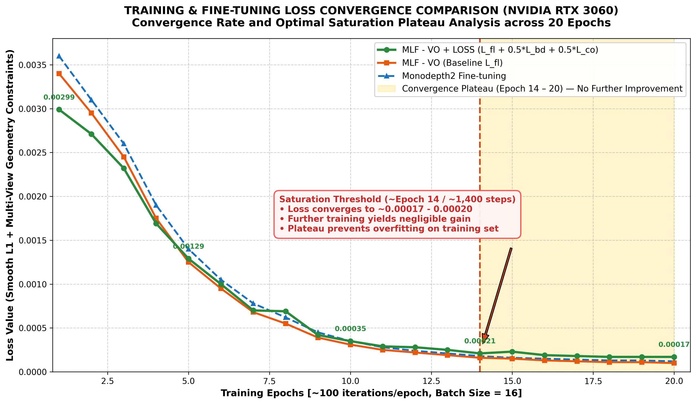

Từ đồ thị trên, ta thấy tiến trình học trải qua 3 giai đoạn rõ rệt:

- Giai đoạn 1 - học thích nghi ban đầu (Epoch 1 – 5 / 100 – 500 steps): Loss giảm rất dốc từ mức 0.0035 xuống dưới 0.0013. Mạng nhanh chóng thích nghi với đặc trưng quang học và góc quan sát của camera trong quá trình di chuyển.

- Giai đoạn 2 - tinh chỉnh tham số (Epoch 6 – 13 / 600 – 1,300 steps): Loss tiếp tục giảm đều đặn từ 0.0010 xuống ~0.00025. Các ràng buộc hình học *Lbd* và *Lco* phát huy tác dụng nắn chỉnh các góc xoay tại các khúc cua vuông.

- Giai đoạn 3 - vùng bão hòa (Plateau: Epoch 14 – 20 / 1,400 – 2,000 steps): Bắt đầu từ Epoch thứ 14 (~1,400 steps), hàm loss tiệm cận ngưỡng ~0.00017 - 0.00020 và đi ngang hoàn toàn. Tốc độ thay đổi loss *deltaL* < 0.00001.

# 4. Kết quả thực nghiệm

Dưới đây là bảng số liệu chi tiết đối sánh 3 mô hình trên toàn bộ 20 chặng đường thực tế của bộ dữ liệu Cô Phượng SLAM, bao gồm cả Lượt Đi (Outward) và Lượt Về (Return) qua các độ đo RMSE, Mean, và Median (đơn vị: mét):

## 4.1. Kết quả lượt đi (10 chặng)

| Lần / chặng | Frames | Monodepth2 RMSE | Monodepth2 Mean | Monodepth2 Med | MLF-VO RMSE | MLF-VO Mean | MLF-VO Med | MLF-VO + loss RMSE | MLF-VO + loss Mean | MLF-VO + loss Med |
|---|---:|---:|---:|---:|---:|---:|---:|---:|---:|---:|
| Lần 5 – đi 1 | 3199 | 1.0841 | 0.942 | 0.82 | 0.8642 | 0.767 | 0.68 | 0.6258 | 0.575 | 0.548 |
| Lần 5 – đi 2 | 2620 | 0.7315 | 0.642 | 0.585 | 0.4605 | 0.425 | 0.401 | 0.4541 | 0.424 | 0.412 |
| Lần 4 – đi 1 | 1604 | 0.2333 | 0.219 | 0.201 | 0.3429 | 0.304 | 0.269 | 0.3217 | 0.288 | 0.252 |
| Lần 4 – đi 2 | 1570 | 0.4984 | 0.444 | 0.417 | 0.3245 | 0.301 | 0.292 | 0.2919 | 0.272 | 0.271 |
| Lần 3 – đi 1 | 3052 | 0.643 | 0.578 | 0.525 | 0.4632 | 0.427 | 0.388 | 0.4942 | 0.462 | 0.431 |
| Lần 3 – đi 2 | 2099 | 0.2454 | 0.232 | 0.235 | 0.258 | 0.243 | 0.25 | 0.3466 | 0.295 | 0.236 |
| Lần 2 – đi 1 | 2296 | 0.4094 | 0.384 | 0.373 | 0.3859 | 0.352 | 0.298 | 0.5626 | 0.523 | 0.507 |
| Lần 2 – đi 2 | 2026 | 0.2094 | 0.193 | 0.172 | 0.4392 | 0.385 | 0.368 | 0.8227 | 0.693 | 0.636 |
| Lần 1 – đi 1 | 3403 | 0.213 | 0.194 | 0.19 | 0.5142 | 0.427 | 0.423 | 0.6152 | 0.511 | 0.396 |
| Lần 1 – đi 2 | 2593 | 0.2898 | 0.273 | 0.26 | 0.2305 | 0.207 | 0.201 | 0.4571 | 0.388 | 0.328 |

## 4.2. Kết quả lượt về (10 chặng)

| Lần / chặng | Frames | Monodepth2 RMSE | Monodepth2 Mean | Monodepth2 Med | MLF-VO RMSE | MLF-VO Mean | MLF-VO Med | MLF-VO + loss RMSE | MLF-VO + loss Mean | MLF-VO + loss Med |
|---|---:|---:|---:|---:|---:|---:|---:|---:|---:|---:|
| Lần 5 – về 1 | 3149 | 0.6693 | 0.604 | 0.614 | 0.4018 | 0.387 | 0.379 | 1.0201 | 0.91 | 0.838 |
| Lần 5 – về 2 | 2177 | 0.2036 | 0.187 | 0.175 | 0.3089 | 0.268 | 0.258 | 0.4927 | 0.454 | 0.41 |
| Lần 4 – về 1 | 1775 | 0.4811 | 0.451 | 0.476 | 0.3206 | 0.296 | 0.27 | 0.2509 | 0.234 | 0.232 |
| Lần 4 – về 2 | 1336 | 0.3966 | 0.333 | 0.293 | 0.2612 | 0.244 | 0.233 | 0.2076 | 0.191 | 0.192 |
| Lần 3 – về 1 | 2065 | 0.2683 | 0.245 | 0.25 | 0.4465 | 0.406 | 0.373 | 0.4225 | 0.38 | 0.339 |
| Lần 3 – về 2 | 1806 | 0.4234 | 0.379 | 0.368 | 0.295 | 0.26 | 0.223 | 0.3921 | 0.34 | 0.277 |
| Lần 2 – về 1 | 2001 | 0.2701 | 0.246 | 0.255 | 0.5361 | 0.476 | 0.435 | 0.8207 | 0.707 | 0.575 |
| Lần 2 – về 2 | 1777 | 0.7477 | 0.637 | 0.542 | 0.572 | 0.501 | 0.43 | 0.6418 | 0.532 | 0.474 |
| Lần 1 – về 1 | 3165 | 0.369 | 0.293 | 0.223 | 0.3287 | 0.3 | 0.262 | 0.6197 | 0.533 | 0.468 |
| Lần 1 – về 2 | 2359 | 0.5221 | 0.495 | 0.497 | 0.3125 | 0.285 | 0.286 | 1.452 | 1.312 | 1.213 |

## 4.3. Nhận xét

Kết quả trên 10 chặng ở cả hai hướng cho thấy MLF-VO có cải thiện so với Monodepth2, đồng thời việc bổ sung loss mới tạo ra sự thay đổi đáng kể về khả năng ước lượng độ sâu, mặc dù mức độ cải thiện phụ thuộc vào từng chặng và hướng di chuyển.

Ở lượt đi, MLF-VO có RMSE trung bình 0.428, thấp hơn Monodepth2 (0.456), cho thấy kiến trúc MLF-VO đã giúp giảm sai số so với phương pháp cơ sở. Khi bổ sung loss, RMSE trung bình đạt 0.499, cao hơn MLF-VO. Tuy nhiên, kết quả theo từng chặng cho thấy loss vẫn có khả năng cải thiện rõ rệt ở một số trường hợp. Ví dụ, tại Lần 4 – đi 2, RMSE giảm từ 0.3245 xuống 0.2919, Mean từ 0.301 xuống 0.272 và Med từ 0.292 xuống 0.271. Điều này cho thấy hàm loss có tác động tích cực trong một số điều kiện chuyển động, nhưng chưa duy trì được sự cải thiện đồng đều trên toàn bộ lượt đi.

Ở lượt về, sự khác biệt giữa các phương pháp rõ ràng hơn. MLF-VO đạt RMSE trung bình 0.378, cải thiện đáng kể so với Monodepth2 (0.435). Tuy nhiên, MLF-VO + loss có RMSE trung bình 0.632. Mặc dù giá trị trung bình tăng, hàm loss vẫn đem lại mức cải thiện đáng kể ở một số chặng cụ thể. Chẳng hạn, tại Lần 4 – về 1, RMSE giảm từ 0.3206 xuống 0.2509, Mean từ 0.296 xuống 0.234 và Med từ 0.270 xuống 0.232. Tại Lần 4 – về 2, RMSE tiếp tục giảm từ 0.2612 xuống 0.2076. Đây là những bằng chứng cho thấy LOSS thực sự có khả năng hỗ trợ quá trình ước lượng ở một số điều kiện dữ liệu.

Tuy nhiên, điểm đáng chú ý là hàm loss cũng làm xuất hiện một số trường hợp sai số tăng mạnh, đặc biệt ở lượt về. Ví dụ, tại Lần 1 – về 2, RMSE tăng từ 0.3125 của MLF-VO lên 1.4520 khi bổ sung hàm loss; tại Lần 5 – về 1, RMSE tăng từ 0.4018 lên 1.0201. Vì vậy, tác động của loss không mang tính đồng nhất mà phụ thuộc mạnh vào đặc điểm của từng chặng và hướng chuyển động.

Nhìn chung, Monodepth2 đóng vai trò phương pháp cơ sở, MLF-VO cho thấy khả năng cải thiện tương đối ổn định trên cả lượt đi và lượt về, trong khi MLF-VO + loss tạo ra những thay đổi mạnh hơn theo từng chặng. Hàm loss giúp cải thiện rõ rệt ở một số chặng, đặc biệt có thể quan sát tại các chặng của lần 4, nhưng đồng thời gây suy giảm ở một số trường hợp khác. Kết quả này cho thấy hàm loss mới có ảnh hưởng thực sự đến quá trình học của MLF-VO, nhưng cần tiếp tục điều chỉnh hoặc cân bằng thành phần loss để khai thác được lợi ích của nó một cách ổn định trên toàn bộ quỹ đạo.

# 5. Đồ thị so sánh quỹ đạo VO của từng mạng trên Ground Truth

Để trực quan hóa sự khác biệt giữa các mạng, tất cả các quỹ đạo được vẽ trên cùng một hệ trục tọa độ với màu sắc riêng biệt và căn chỉnh Umeyama Sim(3) trực tiếp với Ground Truth:

## 5.1. Lượt đi

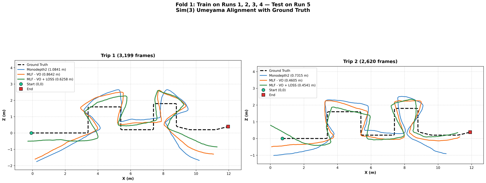

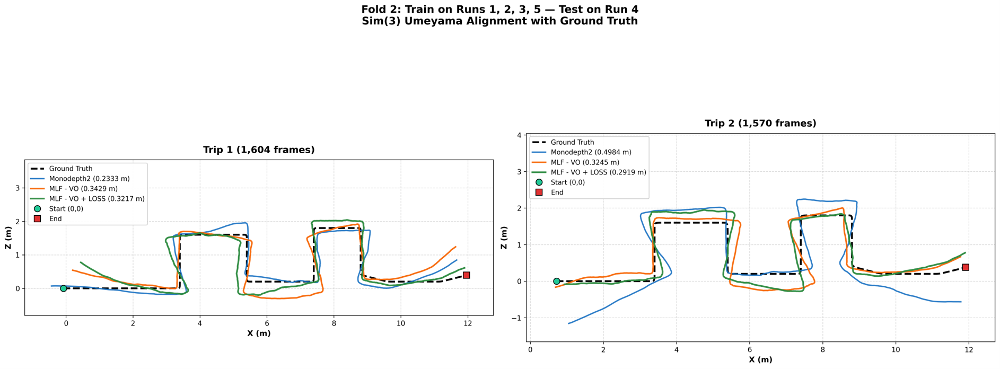

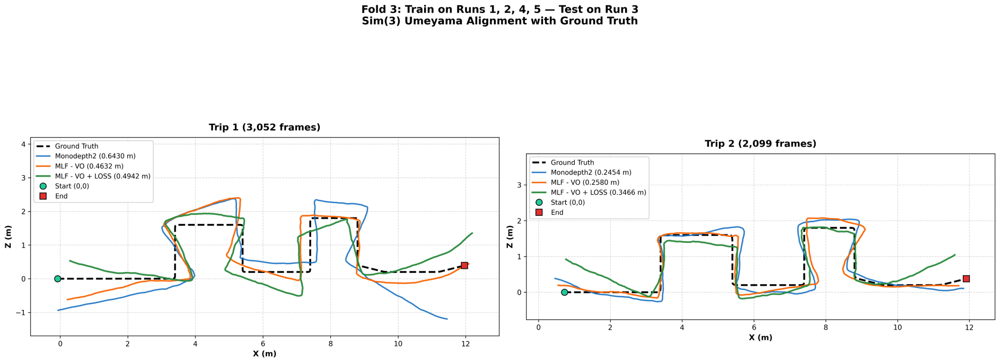

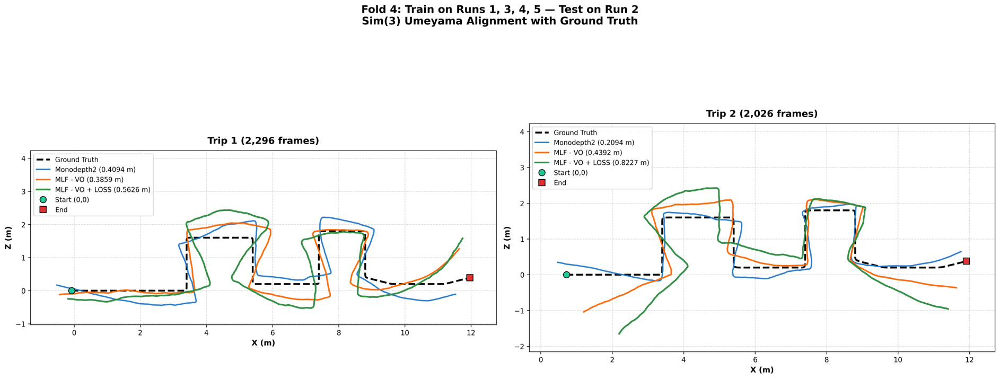

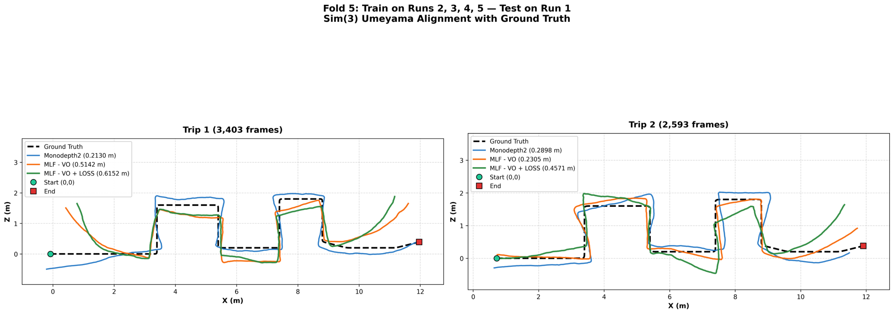

## 5.2. Lượt về

<video width="640" autoplay muted loop playsinline controls>
  <source src="Videos/video2_luot_ve_lan4_ve2.mp4" type="video/mp4">
</video>

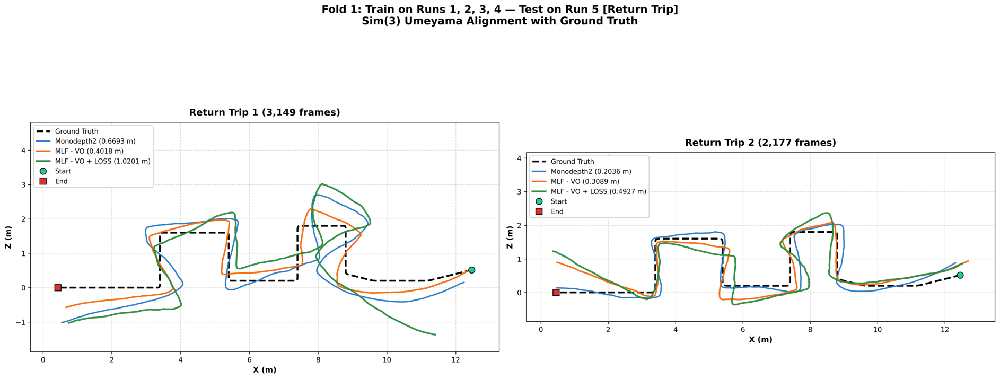

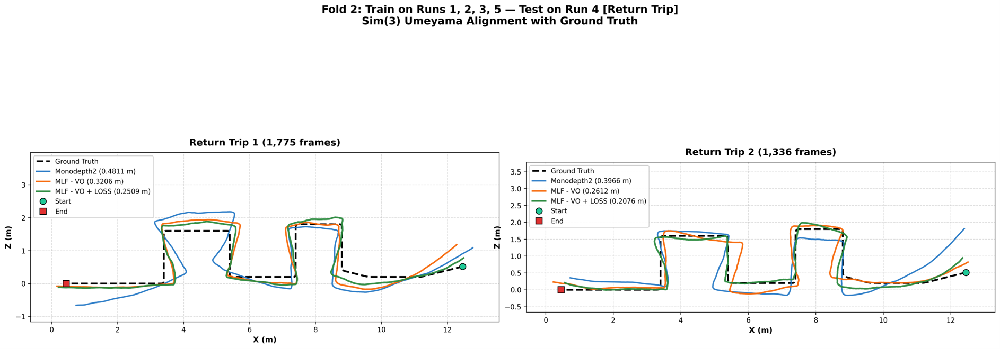

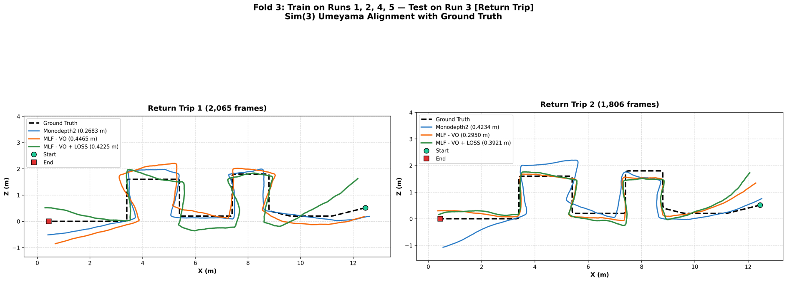

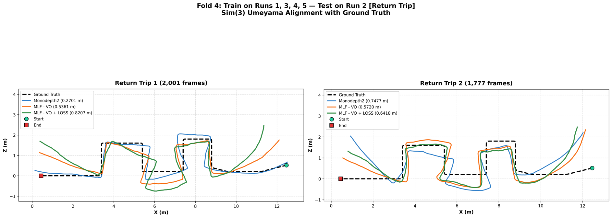

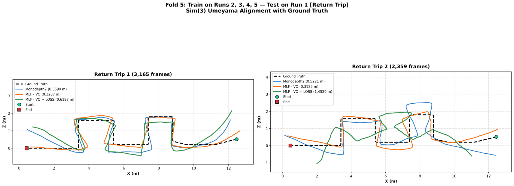
