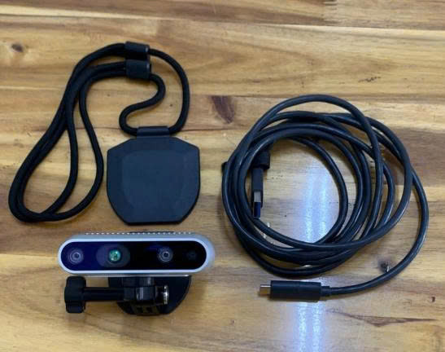
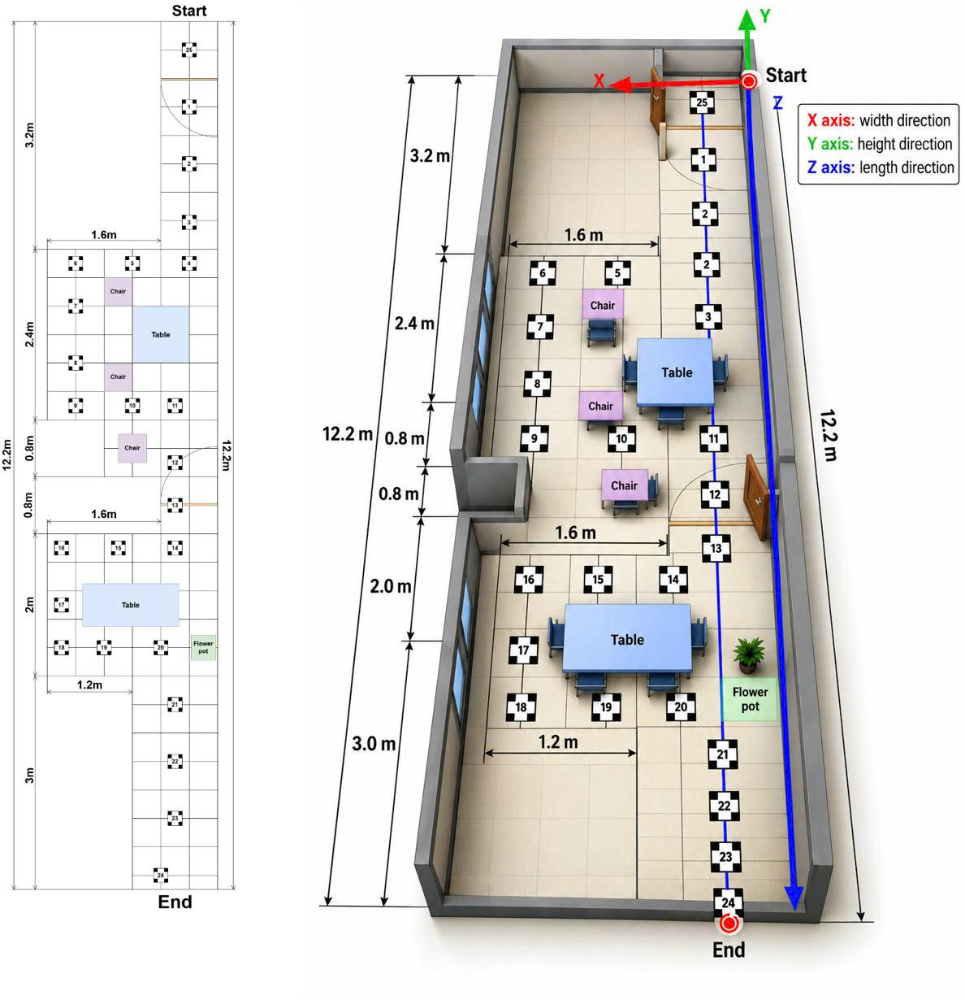
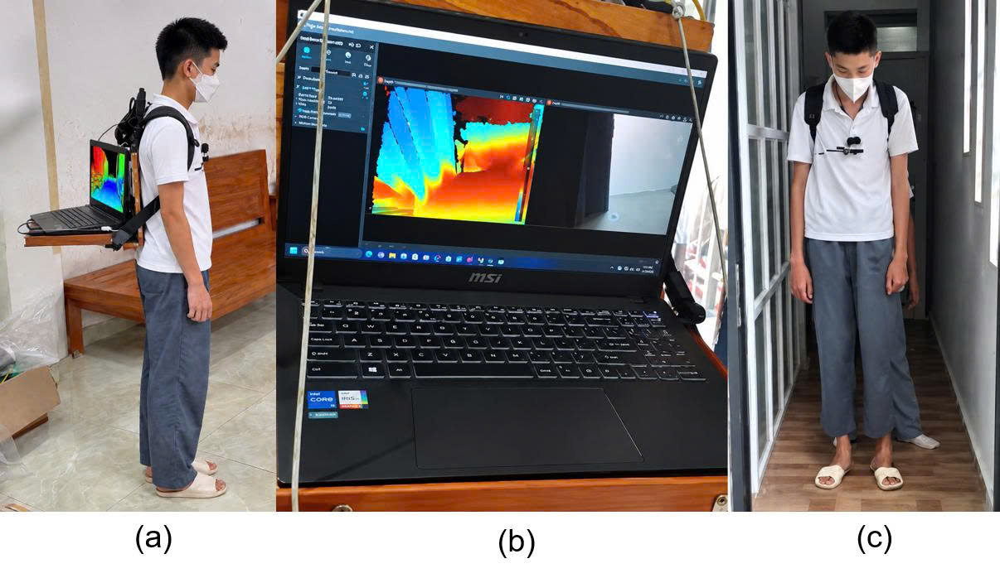

# 1. Quy trình thu thập dữ liệu

## 1.1. Thiết bị thu thập dữ liệu

Nghiên cứu sử dụng camera đo chiều sâu Intel RealSense D435, tích hợp hai cảm biến hồng ngoại, máy chiếu điểm hồng ngoại và camera RGB, cho phép thu thập đồng thời dữ liệu chiều sâu và hình ảnh màu của môi trường. Camera được kết nối với máy tính qua USB 3.0 và sử dụng phần mềm Intel RealSense Viewer để cấu hình, ghi dữ liệu vào tệp định dạng `.bag`.

  

*Hình 1. Camera Intel RealSense D435 sử dụng trong hệ thống thu thập dữ liệu.*

Để ghi lại hình ảnh theo góc nhìn thứ nhất (First-Person View – FPV), hệ thống sử dụng laptop MSI B12MO với bộ xử lý Intel Core i5-1235U, RAM 16 GB và đồ họa tích hợp Intel Iris Xe. Video được ghi ở độ phân giải 640 × 480 pixel, tốc độ 30 khung hình/giây (FPS).

## 1.2. Bối cảnh và bố trí không gian thực nghiệm

Thí nghiệm được thực hiện trong phòng ăn có diện tích khoảng 15 m², với các chướng ngại vật gồm bàn, ghế và chậu hoa nhằm mô phỏng môi trường sinh hoạt trong nhà. Các marker kích thước 10 × 10 cm được bố trí trên sàn để xác định tuyến đường và thứ tự di chuyển của người tham gia.

  

*Hình 2. Sơ đồ bố trí không gian thực nghiệm, vị trí chướng ngại vật và tuyến đường di chuyển theo các marker.*

## 1.3. Bố trí hệ thống ghi hình

Camera được cố định trước ngực người tham gia, hướng về phía trước để ghi nhận môi trường theo hướng di chuyển. Laptop được đeo phía sau lưng nhằm hỗ trợ ghi và lưu trữ dữ liệu trong suốt quá trình thực nghiệm. Trước mỗi lần ghi hình, hệ thống được kiểm tra để bảo đảm thiết bị hoạt động ổn định.

  

*Hình 3. Bố trí thiết bị ghi hình trên người tham gia: (a) tư thế đeo và hướng camera; (b) vị trí laptop phía sau lưng; (c) vị trí bắt đầu thu thập dữ liệu.*

## 1.4. Quy trình di chuyển và tổ chức dữ liệu

Người tham gia di chuyển theo tuyến đường đã xác định, bắt đầu tại marker số 25, đi qua các marker trung gian và kết thúc tại marker số 24. Mỗi video gồm bốn lượt di chuyển liên tiếp:

1. **Lượt đi 1:** từ marker 25 đến marker 24.
2. **Lượt về 1:** từ marker 24 trở lại marker 25.
3. **Lượt đi 2:** từ marker 25 đến marker 24.
4. **Lượt về 2:** từ marker 24 trở lại marker 25.

Quy trình này giúp thu thập dữ liệu theo cả hai hướng di chuyển và tăng tính nhất quán trong quá trình khảo sát môi trường. Thí nghiệm được thực hiện với năm tình nguyện viên, tương ứng năm video. Sau khi ghi hình, dữ liệu được thống kê theo từng video và từng lượt đi, lượt về để kiểm tra số lượng khung hình. Tổng cộng, bộ dữ liệu thu thập được gồm **46.072 khung hình**, phục vụ các bước xử lý và nghiên cứu tiếp theo.

**Bảng 1. Thống kê số lượng khung hình theo từng lượt di chuyển của 5 video**

<table>
  <thead>
    <tr>
      <th align="center">Video</th>
      <th align="center">Lượt</th>
      <th align="center">Số frame</th>
      <th align="center">Video</th>
      <th align="center">Lượt</th>
      <th align="center">Số frame</th>
    </tr>
  </thead>
  <tbody>
    <tr>
      <td align="center" rowspan="4">1</td>
      <td align="center">Đi 1</td>
      <td align="center">3403</td>
      <td align="center" rowspan="4">4</td>
      <td align="center">Đi 1</td>
      <td align="center">1604</td>
    </tr>
    <tr>
      <td align="center">Về 1</td>
      <td align="center">3165</td>
      <td align="center">Về 1</td>
      <td align="center">1775</td>
    </tr>
    <tr>
      <td align="center">Đi 2</td>
      <td align="center">2593</td>
      <td align="center">Đi 2</td>
      <td align="center">1570</td>
    </tr>
    <tr>
      <td align="center">Về 2</td>
      <td align="center">2359</td>
      <td align="center">Về 2</td>
      <td align="center">1336</td>
    </tr>
    <tr>
      <td align="center" rowspan="4">2</td>
      <td align="center">Đi 1</td>
      <td align="center">2296</td>
      <td align="center" rowspan="4">5</td>
      <td align="center">Đi 1</td>
      <td align="center">3199</td>
    </tr>
    <tr>
      <td align="center">Về 1</td>
      <td align="center">2001</td>
      <td align="center">Về 1</td>
      <td align="center">3149</td>
    </tr>
    <tr>
      <td align="center">Đi 2</td>
      <td align="center">2026</td>
      <td align="center">Đi 2</td>
      <td align="center">2620</td>
    </tr>
    <tr>
      <td align="center">Về 2</td>
      <td align="center">1777</td>
      <td align="center">Về 2</td>
      <td align="center">2177</td>
    </tr>
    <tr>
      <td align="center" rowspan="4">3</td>
      <td align="center">Đi 1</td>
      <td align="center">3052</td>
      <td colspan="3"></td>
    </tr>
    <tr>
      <td align="center">Về 1</td>
      <td align="center">2065</td>
      <td colspan="3"></td>
    </tr>
    <tr>
      <td align="center">Đi 2</td>
      <td align="center">2099</td>
      <td colspan="3"></td>
    </tr>
    <tr>
      <td align="center">Về 2</td>
      <td align="center">1806</td>
      <td colspan="3"></td>
    </tr>
  </tbody>
</table>

*Bảng 1. Thống kê số lượng khung hình theo lượt đi và lượt về của năm video thu thập.*

# 4. Kết quả thực nghiệm

Dưới đây là bảng số liệu chi tiết đối sánh 3 mô hình trên toàn bộ 20 chặng đường thực tế của bộ dữ liệu Cô Phượng SLAM, bao gồm cả Lượt Đi (Outward) và Lượt Về (Return) qua các độ đo RMSE, Mean, và Median (đơn vị: mét):

## 4.1. Kết quả lượt đi (10 chặng)

| Lần / chặng | Frames | Monodepth2 RMSE | Monodepth2 Mean | Monodepth2 Med | MLF-VO RMSE | MLF-VO Mean | MLF-VO Med | MLF-VO + loss RMSE | MLF-VO + loss Mean | MLF-VO + loss Med |
|---|---:|---:|---:|---:|---:|---:|---:|---:|---:|---:|
| Lần 5 – đi 1 | 3199 | 1.0841 | 0.942 | 0.82 | 0.8642 | 0.767 | 0.68 | 0.6258 | 0.575 | 0.548 |
| Lần 5 – đi 2 | 2620 | 0.7315 | 0.642 | 0.585 | 0.4605 | 0.425 | 0.401 | 0.4541 | 0.424 | 0.412 |
| Lần 4 – đi 1 | 1604 | 0.2333 | 0.219 | 0.201 | 0.3429 | 0.304 | 0.269 | 0.3217 | 0.288 | 0.252 |
| Lần 4 – đi 2 | 1570 | 0.4984 | 0.444 | 0.417 | 0.3245 | 0.301 | 0.292 | 0.2919 | 0.272 | 0.271 |
| Lần 3 – đi 1 | 3052 | 0.643 | 0.578 | 0.525 | 0.4632 | 0.427 | 0.388 | 0.4942 | 0.462 | 0.431 |
| Lần 3 – đi 2 | 2099 | 0.2454 | 0.232 | 0.235 | 0.258 | 0.243 | 0.25 | 0.3466 | 0.295 | 0.236 |
| Lần 2 – đi 1 | 2296 | 0.4094 | 0.384 | 0.373 | 0.3859 | 0.352 | 0.298 | 0.5626 | 0.523 | 0.507 |
| Lần 2 – đi 2 | 2026 | 0.2094 | 0.193 | 0.172 | 0.4392 | 0.385 | 0.368 | 0.8227 | 0.693 | 0.636 |
| Lần 1 – đi 1 | 3403 | 0.213 | 0.194 | 0.19 | 0.5142 | 0.427 | 0.423 | 0.6152 | 0.511 | 0.396 |
| Lần 1 – đi 2 | 2593 | 0.2898 | 0.273 | 0.26 | 0.2305 | 0.207 | 0.201 | 0.4571 | 0.388 | 0.328 |

