# 1. Introduction

In this paper, we propose and conduct data collection at the homes of BLIND participants in Ha Giang 1 Ward, Tuyen Quang (TQ) Province for VOE purposes, resulting in the TQ-BLINDVOE dataset. The study involved five blind participants—members of the Tuyen Quang Association of the Blind—aged between 22 and 60. The group comprised two men and three women (all totally blind, with heights ranging from 1.5 m to 1.8 m). Data collection was carried out based on specific indoor movement scenarios; each participant performed two round trips (”Out” and ”Back”). Participants wore an RGB-D camera (Intel RealSense D435) mounted on their backs and connected to a laptop via USB to simultaneously capture RGB images and depth data.

  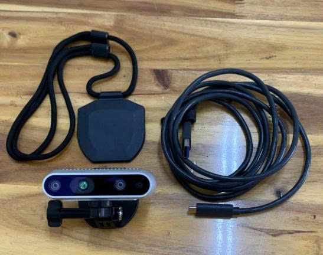

*Figure 1. Intel RealSense D435 camera used in the data collection system.*

Each participant navigated from the restroom door (Start)—following a path marked with points 1 through 25—to the house entrance (End) and back; safety was ensured by an assistant who provided supervision and guidance. 

  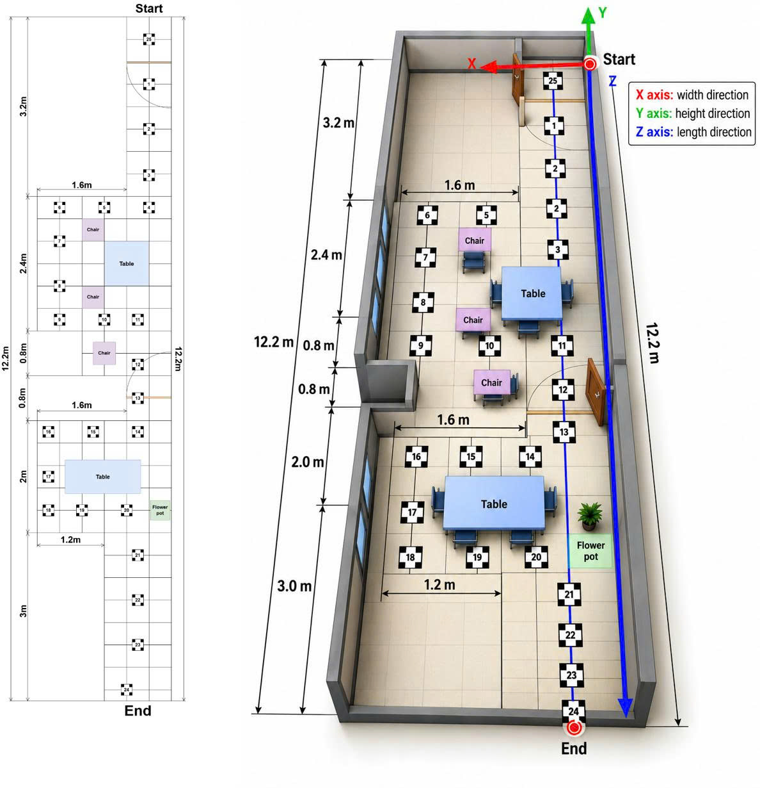

*Figure 2. Experimental environment layout.*

The dataset comprises 46,072 RGB-D frames, with the raw data prepared based on the path marked by points 1 through 25 relative to a pre-defined indoor coordinate system.

**Table 1. The number of RGB-D frames obtained from TQ-BLIND-VOE dataset.**

<table>
<tr>
<td valign="top">

<table>
  <thead>
    <tr>
      <th align="center">Person</th>
      <th align="center">Direction of movement</th>
      <th align="center">#number of frames</th>
    </tr>
  </thead>
  <tbody>
    <tr>
      <td rowspan="4" align="center">Subject #1</td>
      <td>out</td>
      <td>3403</td>
    </tr>
    <tr>
      <td>back</td>
      <td>3165</td>
    </tr>
    <tr>
      <td>out</td>
      <td>2593</td>
    </tr>
    <tr>
      <td>back</td>
      <td>2359</td>
    </tr>
    <tr>
      <td rowspan="4" align="center">Subject #2</td>
      <td>out</td>
      <td>2296</td>
    </tr>
    <tr>
      <td>back</td>
      <td>2001</td>
    </tr>
    <tr>
      <td>out</td>
      <td>2026</td>
    </tr>
    <tr>
      <td>back</td>
      <td>1777</td>
    </tr>
    <tr>
      <td rowspan="4" align="center">Subject #3</td>
      <td>out</td>
      <td>3052</td>
    </tr>
    <tr>
      <td>back</td>
      <td>2065</td>
    </tr>
    <tr>
      <td>out</td>
      <td>2099</td>
    </tr>
    <tr>
      <td>back</td>
      <td>1806</td>
    </tr>
  </tbody>
</table>

</td>
<td valign="top">

<table>
  <thead>
    <tr>
      <th align="center">Person</th>
      <th align="center">Direction of movement</th>
      <th align="center">#number of frames</th>
    </tr>
  </thead>
  <tbody>
    <tr>
      <td rowspan="4" align="center">Subject #4</td>
      <td>out</td>
      <td>1604</td>
    </tr>
    <tr>
      <td>back</td>
      <td>1775</td>
    </tr>
    <tr>
      <td>out</td>
      <td>1570</td>
    </tr>
    <tr>
      <td>back</td>
      <td>1336</td>
    </tr>
    <tr>
      <td rowspan="4" align="center">Subject #5</td>
      <td>out</td>
      <td>3199</td>
    </tr>
    <tr>
      <td>back</td>
      <td>3149</td>
    </tr>
    <tr>
      <td>out</td>
      <td>2620</td>
    </tr>
    <tr>
      <td>back</td>
      <td>2177</td>
    </tr>
  </tbody>
</table>

</td>
</tr>
</table>
*Table 1. The number of RGB-D frames obtained from TQ-BLIND-VOE dataset..*

We also fine-tuned the Monodepth2, MLF–VO, and MLF–VO+LOSS models on the TQ-BLINDVOE dataset for VOE, conducting five runs for each of three data configurations: Configuration #1, using data from the ”Out” trips of four subjects for training and testing on the remaining subject’s Out trips; Configuration #2, using data from the ”Back” trips of four subjects for training and testing on the remaining subject’s Back trips; and Configuration #3, using data from both Out and Back trips of four subjects for training and testing on the remaining subject’s Out and Back trips. The evaluation process was conducted on a like-for-like basis.

The structure of our paper is as follows: Section 1 provides an overview of the VOE problem, representative VOE models, datasets, and the paper’s main contributions. Related research on VOE and VOE evaluation datasets is presented in Section 2. Section 3 details the TQ-BLIND-VOE dataset. Representative models for addressing the VOE problem using RGB-D environmental data are described in Section 4. Section 5 presents the VOE results obtained on the TQ-BLIND-VOE dataset. Finally, the conclusions and directions for future development of this paper are presented.

In this paper, we perform fine-tuning five times for each of three data configurations(Configuration #1, Configuration #2, Configuration #3), resulting in a total of 15 fine-tuning runs on a VOE model.

Configuration #1 consists of five runs: Fold #1 uses data from subject #1, subject #2, subject #3, and subject #4 for training and data from subject #5 for evaluation; Fold #2 uses data from subject #1, subject #2, subject #3, and subject #5 for training and data from subject #4 for evaluation; Fold #3 uses data from subject #1, subject #2, subject #4, and subject #5 for training and data from subject #3 for evaluation; Fold #4 uses data from subject #1, #3, #4, and #5 for training and data from subject #2 for evaluation; and Fold #5 uses data from subject #2, subject #3, subject #4, and subject #5 for training and data from subject #1 for evaluation.

Configuration #2 consists of five cross-validation runs: Fold #1 uses data from subject #1, subject #2, subject #3, and subject #4 for training, and data from subject #5 for evaluation; Fold #2 uses data from subjects #1, #2, #3, and #5 for training, and data from subject #4 for evaluation; Fold #3 uses data from subject #1, subject #2, subject #4, and subject #5 for training, and data from subject #3 for evaluation; Fold #4 uses data from subject #1, subject #3, subject #4, and subject #5 for training, and data from subject #2 for evaluation; Fold #5 uses data from subject #2, subject #3, subject #4, and subject #5 for training, and data from subject #1 for evaluation.

Configuration #3 consists of five runs based on subject data (including data from two out and two back trips): Fold #1 (both out and back trips): training data from subject #1, subject #2, subject #3, and subject #4; evaluation data from subject #5. Fold #2 (both out and back trips): training data from subject #1, subject #2, subject #3, and subject #5; evaluation data from subject #4. Fold #3 (both out and back trips): training data from subject #1, subject #2, subject #4, and subject #5; evaluation data from subject #3. Fold #4 (both out and back trips): training data from subject #1, subject #3, subject #4, and subject #5; evaluation data from subject #2. Fold #5 (both out and back trips): training data from subject #2, subject #3, subject #4, and subject #5; evaluation data from subject #1.

The structure of this paper is as follows: Section 1 provides an overview of the VOE problem, representative VOE models, datasets, and the main contributions of this paper. Related studies on VOE and datasets for VOE evaluation are presented in Section 2. Section 3 introduces the TQ-BLIND-VOE dataset. Representative models for addressing the VOE problem based on RGB-D data from the environment are presented in Section 4. Section 5 presents the VOE results on the TQ-BLIND-VOE dataset. Finally, the paper concludes with conclusions and future research directions.

# 2. Method for Calculating Evaluation Metrics

To quantitatively evaluate the accuracy of Visual Odometry (VO) algorithms, the trajectory estimated by the model needs to be directly compared with the obtained Ground Truth trajectory. The evaluation process is standardized through rigorous mathematical steps.

## 2.1. Spatiotemporal synchronization and Sim(3) similarity alignment Umeyama

**Time synchronization:** Assume the actual location sequence consists of $N$ pose Ground Truth $Q = \{Q_1, Q_2, Q_3, \ldots, Q_N\}$ and the sequence of estimated poses $P = \{P_1, P_2, P_3, \ldots, P_N\}$, with $Q_i, P_i \in SE(3)$.

**Sim(3) Scale and Orientation Alignment:** Since monocular VO or deep learning networks often suffer from scale ambiguity and different initial coordinate systems, the Umeyama Alignment algorithm is applied to find the optimal Sim(3) similarity transformation, consisting of a scale factor $s > 0$, a rotation matrix $R \in SO(3)$, and a translation vector $t \in \mathbb{R}^3$, such that the squared error between the two trajectories is minimized:

$$
\min_{s,R,t} \frac{1}{N}\sum_{i=1}^{N}
\left\|Q_i-(sRP_i+t)\right\|^2
$$

Here, $P_i$ represents the position coordinates of the estimated trajectory, and $Q_i$ represents the corresponding position coordinates of the Ground Truth trajectory. This alignment brings the two trajectories into the same coordinate system and scale before calculating the evaluation metrics.

## 1.2. Absolute Pose Error (APE) at Each Frame

After the estimated trajectory has been similarity-aligned to the same coordinate system as the Ground Truth, the distance deviation error $e_i$ (in meters) at the $i$-th frame is defined as the Euclidean distance between the ground-truth coordinates and the estimated coordinates:

$$
e_i = \left\| \mathrm{trans}(Q_i) - \mathrm{trans}(P'_i) \right\|_2
$$

$$
e_i = \sqrt{(x_i^{gt} - x_i^{est\_aligned})^2 + (y_i^{gt} - y_i^{est\_aligned})^2 + (z_i^{gt} - z_i^{est\_aligned})^2}
$$

In there:

$$
Q_i = [x_i^{gt}, y_i^{gt}, z_i^{gt}]^T
$$

is the origin coordinate of the Ground Truth.

$$
P'_i = [x_i^{est\_aligned}, y_i^{est\_aligned}, z_i^{est\_aligned}]^T
$$

is the estimated coordinate after being multiplied by the transformation matrix Sim(3).
## 2.3. Metrics for evaluating trajectory errors (ATE)

### 2.3.1. RMSE metric (Root Mean Square Error)

The square root of the mean squared error. It heavily penalizes large errors. This is the most important metric for assessing cumulative drift or significant instances of tracking loss.

$$
RMSE = \sqrt{\frac{1}{N}\sum_{i=1}^{N} e_i^2}
$$

### 2.3.2. Median error

The average error value per frame. This reflects the model's overall deviation from expectations, providing insight into the average accuracy throughout the entire trajectory.

$$
Mean = \frac{1}{N}\sum_{i=1}^{N} e_i
$$

### 2.3.3. MMedian error

The value at the 50th percentile after sorting the sequence of errors in ascending order. It is highly robust to outliers, reflecting the accuracy of the vast majority of frames without being skewed by a few localized erroneous segments.

$$
\mathrm{Median} = \mathrm{median}( \{e_1, e_2, \ldots, e_N\} )
$$

### 2.3.4. Standard deviation Std

The degree of variation of the error around the mean value. A smaller standard deviation (Std) indicates that the trajectory estimation algorithm is more stable, smoother, and less prone to erratic fluctuations.

$$
Std = \sqrt{\frac{1}{N}\sum_{i=1}^{N}(e_i - Mean)^2}
$$

# 3. Comparison of model configurations

| Model Parameters | Monodepth2 | MLF–VO | MLF–VO + LOSS |
|---|---|---|---|
| **Number of Pose Network Parameters** | 13.01M | 42.92M | 42.92M |
| **Auxiliary Depth Estimation Network** | - | 14.84M | 14.84M |
| **Feature Extraction Backbone** | Single-branch ResNet-18 | Dual ResNet-18 (RGB + Depth) | Dual ResNet-18 (RGB + Depth) |
| **Feature Fusion Mechanism** | - | Channel Exchange (50% channel exchange) | Channel Exchange (50% channel exchange) |
| **Processing Speed (GPU RTX 3060)** | ~65 FPS | ~38 FPS | ~38 FPS |
| **Computational Complexity** | ~4.5 GFLOPs | ~12.8 GFLOPs | ~12.8 GFLOPs |

# 4. Loss Convergence Graph

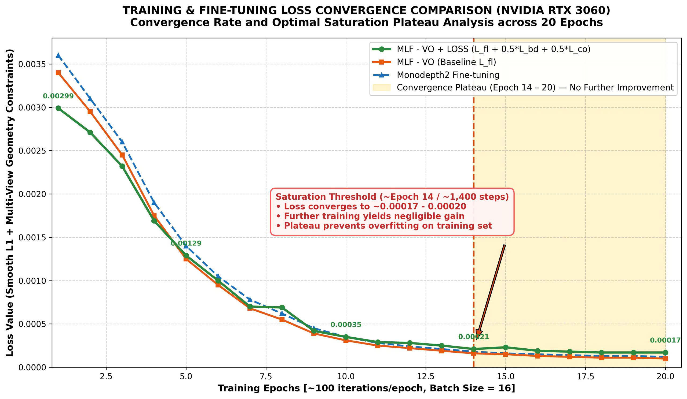

From the graph above, we can observe that the learning process undergoes three distinct stages:

- **Stage 1 – Initial Adaptation (Epochs 1–5 / 100–500 steps):** The loss decreases sharply from 0.0035 to below 0.0013. The network quickly adapts to the optical characteristics and camera viewing angles during movement.

- **Stage 2 – Parameter Fine-Tuning (Epochs 6–13 / 600–1,300 steps):** The loss continues to decrease steadily from 0.0010 to approximately 0.00025. The geometric constraints *Lbd* and *Lco* help refine the rotation angles at right-angle turns.

- **Stage 3 – Plateau Region (Epochs 14–20 / 1,400–2,000 steps):** Starting from Epoch 14 (approximately 1,400 steps), the loss function approaches a threshold of approximately 0.00017–0.00020 and becomes nearly completely flat. The rate of change in loss, *deltaL*, is less than 0.00001.

# 5. Experimental Results

The following table presents a detailed comparison of the three models across all 20 actual trajectories in the Co Phuong SLAM dataset, including both Outward and Return sequences, using the RMSE, Mean, and Median metrics (unit: meters):

## 5.1. Outward Results (10 Trajectories)

<table>
  <thead>
    <tr>
      <th colspan="12" align="center"><b>VOE result of Configuration #1</b></th>
    </tr>
    <tr>
      <th rowspan="2" align="center"><b>Subject</b></th>
      <th rowspan="2" align="center"><b>Direction of movement</b></th>
      <th rowspan="2" align="center"><b>#Frames</b></th>
      <th colspan="3" align="center"><b>Monodepth2</b></th>
      <th colspan="3" align="center"><b>MLF-VO</b></th>
      <th colspan="3" align="center"><b>MLF-VO + LOSS</b></th>
    </tr>
    <tr>
      <th align="center"><b>RMSE (m)</b></th>
      <th align="center"><i>Mean</i> <b>(m)</b></th>
      <th align="center"><i>Med</i> <b>(m)</b></th>
      <th align="center"><i>RMSE</i> <b>(m)</b></th>
      <th align="center"><i>Mean</i> <b>(m)</b></th>
      <th align="center"><i>Med</i> <b>(m)</b></th>
      <th align="center"><i>RMSE</i> <b>(m)</b></th>
      <th align="center"><i>Mean</i> <b>(m)</b></th>
      <th align="center"><i>Med</i> <b>(m)</b></th>
    </tr>
  </thead>
  <tbody>
    <tr>
      <td rowspan="2" align="center">Subject #5</td>
      <td>Out 1</td>
      <td>3199</td>
      <td>1.0841</td>
      <td>0.942</td>
      <td>0.82</td>
      <td>0.8642</td>
      <td>0.767</td>
      <td>0.68</td>
      <td>0.6258</td>
      <td>0.575</td>
      <td>0.548</td>
    </tr>
    <tr>
      <td>Out 2</td>
      <td>2620</td>
      <td>0.7315</td>
      <td>0.642</td>
      <td>0.585</td>
      <td>0.4605</td>
      <td>0.425</td>
      <td>0.401</td>
      <td>0.4541</td>
      <td>0.424</td>
      <td>0.412</td>
    </tr>
    <tr>
      <td rowspan="2" align="center">Subject #4</td>
      <td>Out 1</td>
      <td>1604</td>
      <td>0.2333</td>
      <td>0.219</td>
      <td>0.201</td>
      <td>0.3429</td>
      <td>0.304</td>
      <td>0.269</td>
      <td>0.3217</td>
      <td>0.288</td>
      <td>0.252</td>
    </tr>
    <tr>
      <td>Out 2</td>
      <td>1570</td>
      <td>0.4984</td>
      <td>0.444</td>
      <td>0.417</td>
      <td>0.3245</td>
      <td>0.301</td>
      <td>0.292</td>
      <td>0.2919</td>
      <td>0.272</td>
      <td>0.271</td>
    </tr>
    <tr>
      <td rowspan="2" align="center">Subject #3</td>
      <td>Out 1</td>
      <td>3052</td>
      <td>0.643</td>
      <td>0.578</td>
      <td>0.525</td>
      <td>0.4632</td>
      <td>0.427</td>
      <td>0.388</td>
      <td>0.4942</td>
      <td>0.462</td>
      <td>0.431</td>
    </tr>
    <tr>
      <td>Out 2</td>
      <td>2099</td>
      <td>0.2454</td>
      <td>0.232</td>
      <td>0.235</td>
      <td>0.258</td>
      <td>0.243</td>
      <td>0.25</td>
      <td>0.3466</td>
      <td>0.295</td>
      <td>0.236</td>
    </tr>
    <tr>
      <td rowspan="2" align="center">Subject #2</td>
      <td>Out 1</td>
      <td>2296</td>
      <td>0.4094</td>
      <td>0.384</td>
      <td>0.373</td>
      <td>0.3859</td>
      <td>0.352</td>
      <td>0.298</td>
      <td>0.5626</td>
      <td>0.523</td>
      <td>0.507</td>
    </tr>
    <tr>
      <td>Out 2</td>
      <td>2026</td>
      <td>0.2094</td>
      <td>0.193</td>
      <td>0.172</td>
      <td>0.4392</td>
      <td>0.385</td>
      <td>0.368</td>
      <td>0.8227</td>
      <td>0.693</td>
      <td>0.636</td>
    </tr>
    <tr>
      <td rowspan="2" align="center">Subject #1</td>
      <td>Out 1</td>
      <td>3403</td>
      <td>0.213</td>
      <td>0.194</td>
      <td>0.19</td>
      <td>0.5142</td>
      <td>0.427</td>
      <td>0.423</td>
      <td>0.6152</td>
      <td>0.511</td>
      <td>0.396</td>
    </tr>
    <tr>
      <td>Out 2</td>
      <td>2593</td>
      <td>0.2898</td>
      <td>0.273</td>
      <td>0.26</td>
      <td>0.2305</td>
      <td>0.207</td>
      <td>0.201</td>
      <td>0.4571</td>
      <td>0.388</td>
      <td>0.328</td>
    </tr>
  </tbody>
</table>

*Table 2. Quantitative comparison of Monodepth2, MLF–VO, and MLF–VO+LOSS on the Out sequences.*

## 5.2. Results of the second leg (10 stages)

<table>
  <thead>
    <tr>
      <th colspan="12" align="center"><b>Result of Configuration #2</b></th>
    </tr>
    <tr>
      <th rowspan="2" align="left"><b>Subjects</b></th>
      <th rowspan="2" align="center"><b>Direction of movement</b></th>
      <th rowspan="2" align="center"><b>#Frames</b></th>
      <th colspan="3" align="center"><b>Monodepth2</b></th>
      <th colspan="3" align="center"><b>MLF-VO</b></th>
      <th colspan="3" align="center"><b>MLF-VO +LOSS</b></th>
    </tr>
    <tr>
      <th align="center"><b>RMSE (m)</b></th>
      <th align="center"><i>Mean</i> <b>(m)</b></th>
      <th align="center"><i>Med</i> <b>(m)</b></th>
      <th align="center"><i>RMSE</i> <b>(m)</b></th>
      <th align="center"><i>Mean</i> <b>(m)</b></th>
      <th align="center"><i>Med</i> <b>(m)</b></th>
      <th align="center"><i>RMSE</i> <b>(m)</b></th>
      <th align="center"><i>Mean</i> <b>(m)</b></th>
      <th align="center"><b>Med (m)</b></th>
    </tr>
  </thead>
  <tbody>
    <tr>
      <td rowspan="2" align="center">Subject #5</td>
      <td>Back 1</td>
      <td align="center">3149</td>
      <td align="center">0.6693</td>
      <td align="center">0.604</td>
      <td align="center">0.614</td>
      <td align="center">0.4018</td>
      <td align="center">0.387</td>
      <td align="center">0.379</td>
      <td align="center">1.0201</td>
      <td align="center">0.91</td>
      <td align="center">0.838</td>
    </tr>
    <tr>
      <td>Back 2</td>
      <td align="center">2177</td>
      <td align="center">0.2036</td>
      <td align="center">0.187</td>
      <td align="center">0.175</td>
      <td align="center">0.3089</td>
      <td align="center">0.268</td>
      <td align="center">0.258</td>
      <td align="center">0.4927</td>
      <td align="center">0.454</td>
      <td align="center">0.41</td>
    </tr>
    <tr>
      <td rowspan="2" align="center">Subject #4</td>
      <td>Back 1</td>
      <td align="center">1775</td>
      <td align="center">0.4811</td>
      <td align="center">0.451</td>
      <td align="center">0.476</td>
      <td align="center">0.3206</td>
      <td align="center">0.296</td>
      <td align="center">0.27</td>
      <td align="center">0.2509</td>
      <td align="center">0.234</td>
      <td align="center">0.232</td>
    </tr>
    <tr>
      <td>Back 2</td>
      <td align="center">1336</td>
      <td align="center">0.3966</td>
      <td align="center">0.333</td>
      <td align="center">0.293</td>
      <td align="center">0.2612</td>
      <td align="center">0.244</td>
      <td align="center">0.233</td>
      <td align="center">0.2076</td>
      <td align="center">0.191</td>
      <td align="center">0.192</td>
    </tr>
    <tr>
      <td rowspan="2" align="center">Subject #3</td>
      <td>Back 1</td>
      <td align="center">2065</td>
      <td align="center">0.2683</td>
      <td align="center">0.245</td>
      <td align="center">0.25</td>
      <td align="center">0.4465</td>
      <td align="center">0.406</td>
      <td align="center">0.373</td>
      <td align="center">0.4225</td>
      <td align="center">0.38</td>
      <td align="center">0.339</td>
    </tr>
    <tr>
      <td>Back 2</td>
      <td align="center">1806</td>
      <td align="center">0.4234</td>
      <td align="center">0.379</td>
      <td align="center">0.368</td>
      <td align="center">0.295</td>
      <td align="center">0.26</td>
      <td align="center">0.223</td>
      <td align="center">0.3921</td>
      <td align="center">0.34</td>
      <td align="center">0.277</td>
    </tr>
    <tr>
      <td rowspan="2" align="center">Subject #2</td>
      <td>Back 1</td>
      <td align="center">2001</td>
      <td align="center">0.2701</td>
      <td align="center">0.246</td>
      <td align="center">0.255</td>
      <td align="center">0.5361</td>
      <td align="center">0.476</td>
      <td align="center">0.435</td>
      <td align="center">0.8207</td>
      <td align="center">0.707</td>
      <td align="center">0.575</td>
    </tr>
    <tr>
      <td>Back 2</td>
      <td align="center">1777</td>
      <td align="center">0.7477</td>
      <td align="center">0.637</td>
      <td align="center">0.542</td>
      <td align="center">0.572</td>
      <td align="center">0.501</td>
      <td align="center">0.43</td>
      <td align="center">0.6418</td>
      <td align="center">0.532</td>
      <td align="center">0.474</td>
    </tr>
    <tr>
      <td rowspan="2" align="center">Subject #1</td>
      <td>Back 1</td>
      <td align="center">3165</td>
      <td align="center">0.369</td>
      <td align="center">0.293</td>
      <td align="center">0.223</td>
      <td align="center">0.3287</td>
      <td align="center">0.3</td>
      <td align="center">0.262</td>
      <td align="center">0.6197</td>
      <td align="center">0.533</td>
      <td align="center">0.468</td>
    </tr>
    <tr>
      <td>Back 2</td>
      <td align="center">2359</td>
      <td align="center">0.5221</td>
      <td align="center">0.495</td>
      <td align="center">0.497</td>
      <td align="center">0.3125</td>
      <td align="center">0.285</td>
      <td align="center">0.286</td>
      <td align="center">1.452</td>
      <td align="center">1.312</td>
      <td align="center">1.213</td>
    </tr>
  </tbody>
</table>

*Table 3. Quantitative comparison of Monodepth2, MLF–VO, and MLF–VO+LOSS on the Back sequences.*

## 5.3. Discussion

The results across the 10 trajectories in both directions show that MLF-VO improves upon Monodepth2, while the addition of the new loss function leads to significant changes in depth estimation performance, although the degree of improvement depends on the individual trajectory and direction of movement.

For the outward sequences, MLF-VO achieves an average RMSE of 0.428, lower than that of Monodepth2 (0.456), indicating that the MLF-VO architecture helps reduce errors compared with the baseline method. When the loss function is added, the average RMSE reaches 0.499, which is higher than that of MLF-VO. However, the results for individual trajectories show that the loss function can still provide clear improvements in certain cases. For example, in Run 4 – Outward 2, the RMSE decreases from 0.3245 to 0.2919, the Mean decreases from 0.301 to 0.272, and the Median (Med) decreases from 0.292 to 0.271. This indicates that the loss function has a positive effect under certain motion conditions, but the improvement is not consistent across all outward sequences.

For the return sequences, the differences between the methods are more pronounced. MLF-VO achieves an average RMSE of 0.378, representing a significant improvement over Monodepth2 (0.435). However, MLF-VO + Loss has an average RMSE of 0.632. Despite the increase in the average error, the loss function still provides substantial improvements on certain trajectories. For instance, in Run 4 – Return 1, the RMSE decreases from 0.3206 to 0.2509, the Mean decreases from 0.296 to 0.234, and the Median decreases from 0.270 to 0.232. In Run 4 – Return 2, the RMSE further decreases from 0.2612 to 0.2076. These results demonstrate that the loss function can indeed support the estimation process under certain data conditions.

However, it is worth noting that the loss function also leads to substantial increases in error in some cases, particularly in the return sequences. For example, in Run 1 – Return 2, the RMSE increases from 0.3125 with MLF-VO to 1.4520 after adding the loss function; in Run 5 – Return 1, the RMSE increases from 0.4018 to 1.0201. Therefore, the effect of the loss function is not consistent but depends strongly on the characteristics of each trajectory and the direction of movement.

Overall, Monodepth2 serves as the baseline method, MLF-VO demonstrates relatively consistent improvements in both outward and return sequences, while MLF-VO + Loss produces more pronounced changes across individual trajectories. The loss function provides clear improvements on certain trajectories, particularly those observed in Run 4, but also leads to performance degradation in other cases. These results indicate that the new loss function has a tangible impact on the learning process of MLF-VO, but further adjustment or balancing of the loss components is needed to achieve its benefits more consistently across the entire trajectory.

# 6. Graph Comparing the VO Trajectories of Each Network with Ground Truth

To visualize the differences between the networks, all trajectories are plotted on the same coordinate system using distinct colors and aligned directly with the Ground Truth using Umeyama Sim(3):

## 6.1. Outward Sequences

[▶ Watch the Outward Sequence Video](https://drive.google.com/file/d/1KjEL3B-ZuKWq3SkbPUfHEyY-iKu77nSV/view?usp=drive_link)

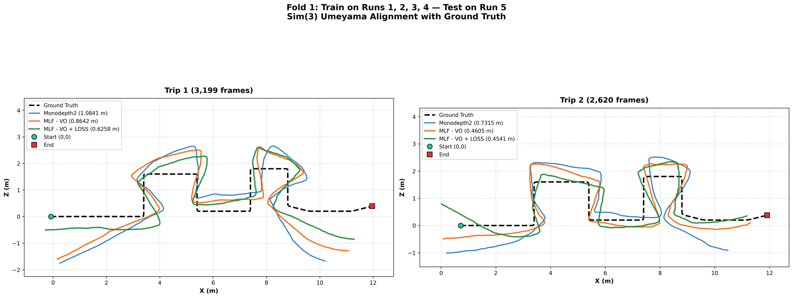

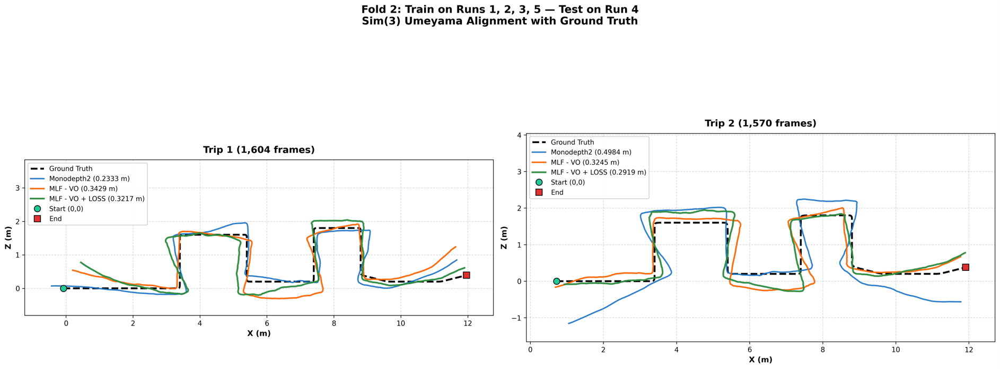

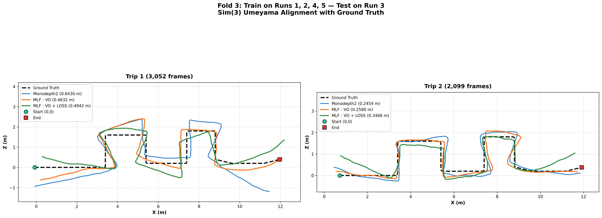

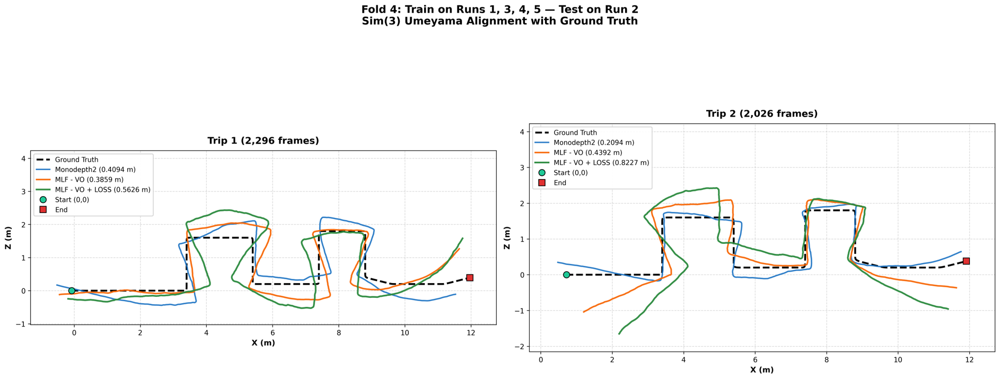

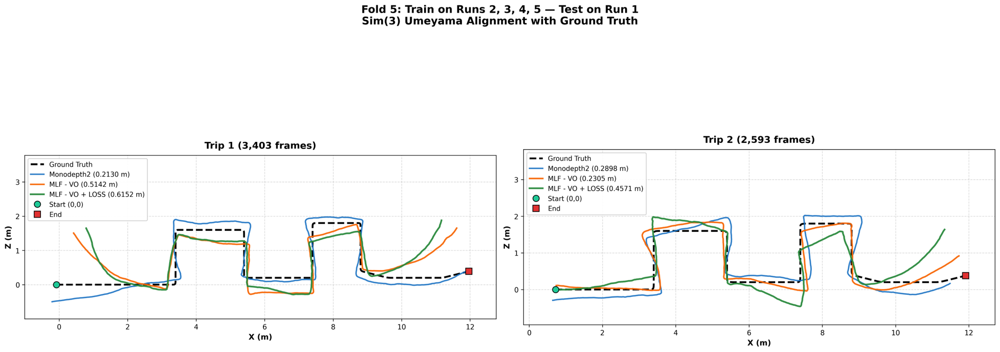

## 6.2. Return Sequences

[▶ Watch the Return Sequence Video](https://drive.google.com/file/d/1kW1N34U80775hqHi98vsKY0sEaqMD0fd/view?usp=drive_link)

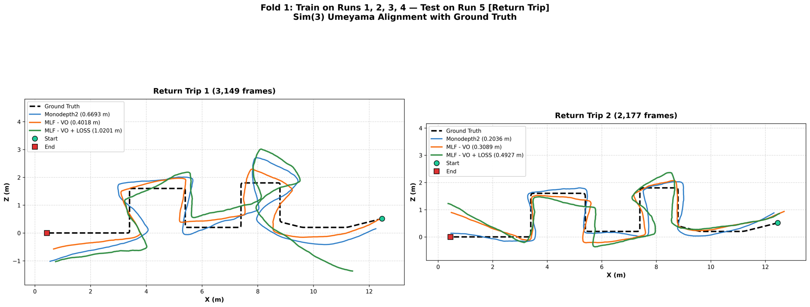

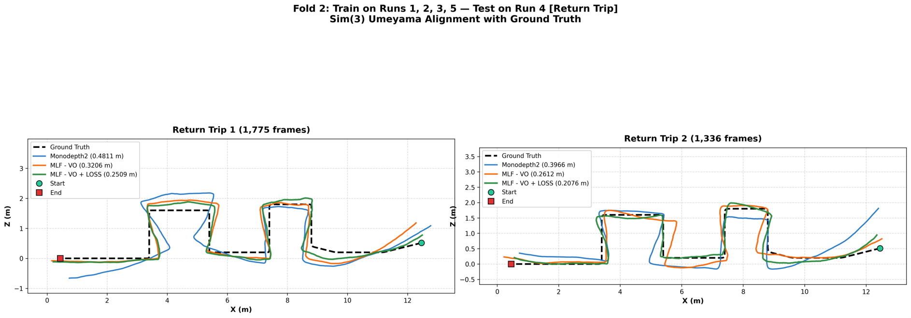

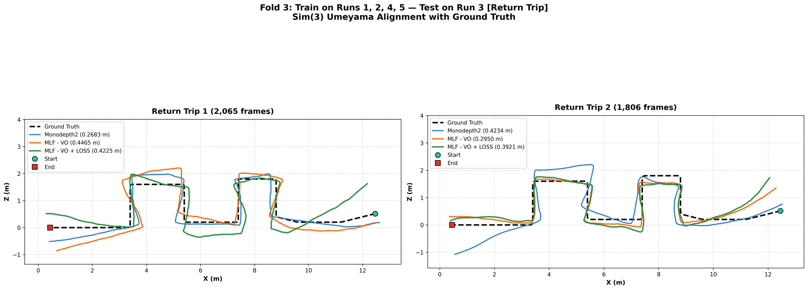

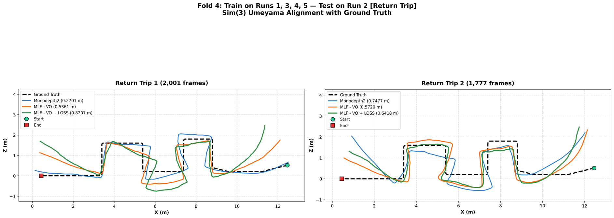

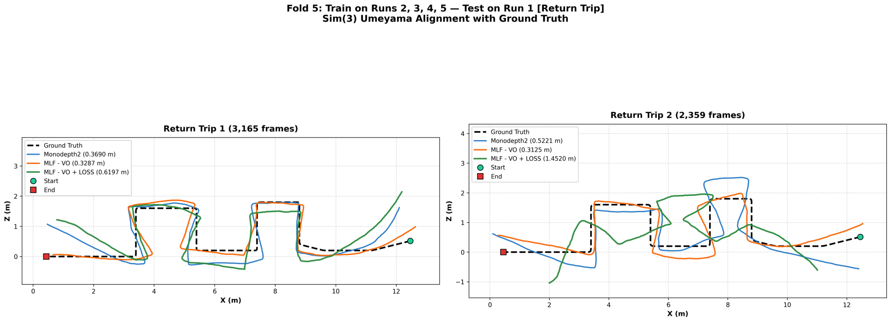

# 7. TQ-BLIND-VOE Resources

1. RGB-D Data: [Download here](https://drive.google.com/drive/folders/16y2ZCAjDTXljfR74gI5BBW_KTbL6eSqG?usp=drive_link)
2. Images of the Four Marked Points: [Download here](https://drive.google.com/drive/folders/1lLeeIbW2P5X5z_o7ziPXw7AyPJj4-P_H?usp=drive_link)
3. Physical Coordinate Table of the House: [Download here](https://drive.google.com/drive/folders/1wqTpLEqYlRArhj6MTwE1XOTshG7hiD9B?usp=drive_link)
4. Transformation Matrix: [Download here](https://drive.google.com/drive/folders/1vf-cKKE6Nf7POh6Ph-6uqwsfhsywuKh9?usp=drive_link)
